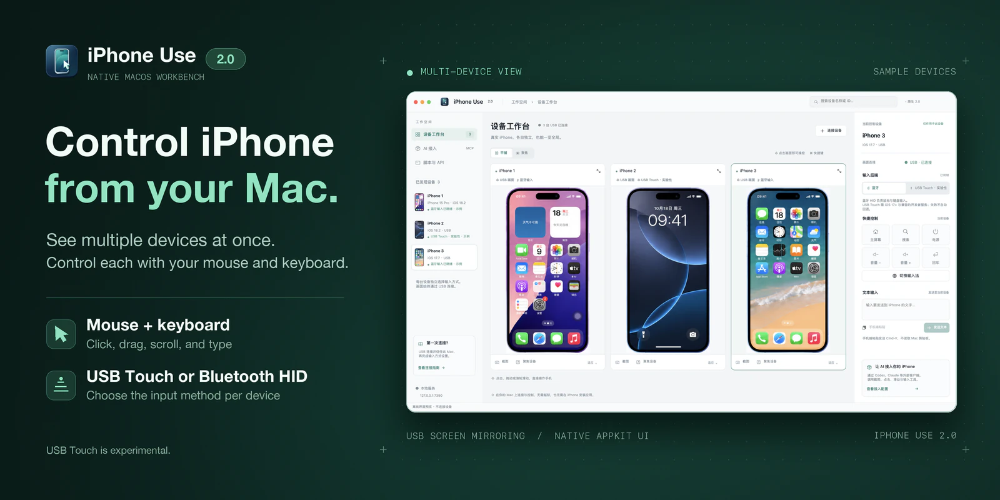

# iPhone Use

**Control a real iPhone from your Mac with a mouse and keyboard.** Mirror multiple devices over USB and connect AI agents. No jailbreak or iPhone app required.

[简体中文](README.md) | English

[Download for macOS](https://github.com/YueChen-C/iPhone-use/releases) · [Quick Start](#quick-start) · [AI Integration](#ai-integration)



## Hands-on Demo

https://github.com/user-attachments/assets/e4aa9473-3236-4573-9841-bfbf83e248e1

## Features

- **Multi-device USB mirroring:** View and control multiple iPhones individually in one native macOS workbench.
- **Mac mouse and keyboard:** Click, drag, scroll, and type. Choose Bluetooth or experimental USB touch per device.
- **App management:** Open **Quick controls → App Management** for the selected device. The list includes third-party and user-facing system apps, not hidden system components. Search by app name or bundle ID, then launch or force quit an app. The list refreshes when opened, on demand, and after an action. Running means the main process exists, not that the app is in the foreground. Process status and app actions require Apple developer services. On iOS 15/16, Xcode is not required: if neither a mounted nor a matching local developer image is available, iPhone Use downloads a checksum-pinned image from Gitee and attempts to mount it. Unavailable states are shown as Unknown.
- **AI and script automation:** Use MCP or the local HTTP API to select a device, capture its screen, and run actions.

## Quick Start

1. On **macOS 14+**, download `iPhoneUse-v<version>-macOS-universal.zip` from **Assets** on the [Releases page](https://github.com/YueChen-C/iPhone-use/releases). Extract `iPhoneUse.app` and move it to Applications. The build supports Apple Silicon and Intel but is not notarized. If macOS blocks it, confirm the download source and follow the Privacy & Security prompt.
2. Connect and unlock your iPhone with a USB data cable. Trust the Mac and grant camera access on macOS for mirroring.
3. Choose an input backend in the workbench. **iOS 17.3+ defaults to USB touch**; older versions default to Bluetooth. Bluetooth requires permission, pairing, and AssistiveTouch. Experimental USB touch requires iOS 17+, a compatible Apple Silicon Mac, Developer Mode, and a compatible Developer Disk Image (DDI).

[Build from source](docs/user-guide.md#1-获取代码并启动) · [Connect and pair](docs/user-guide.md#2-连接手机并授权) · [USB touch setup](docs/user-guide.md#实验性原生-usb-触控) · [Troubleshooting](docs/user-guide.md#常见问题与限制) (guide in Chinese)

## AI Integration

Keep `iPhoneUse.app` running. If you installed it in Applications, register the MCP server with Codex CLI:

```sh
codex mcp add iphone-use -- /Applications/iPhoneUse.app/Contents/MacOS/iphone-use mcp
```

Start a new Codex session to select a device, view its screen, and control it. For other clients or source builds, see the [MCP setup guide](docs/user-guide.md#接入-ai-agentmcp).

## Documentation

- [User guide](docs/user-guide.md) (Chinese): window controls, language switching, calibration, multiple devices, and recording.
- [HTTP API](docs/user-guide.md#http-api) · [Native Accessibility Tree](docs/native-ax-tree.md#english-usage): request examples, device requirements, and compatibility limits.
- [Native app management](docs/native-app-management.md): list installed apps, identify the foreground app, and launch or force-stop an app by bundle ID. On iOS 17+, a launch can optionally pass an HTTP(S) URL to the specified app.
- [Development and validation](docs/user-guide.md#开发与验证) · [Architecture](docs/architecture.md) · [Releasing](docs/releasing.md) · [Changelog](CHANGELOG.md)

Use this project only on devices you own or are authorized to control. Confirm sensitive actions such as sending messages, making payments, or deleting data, and review what device data is shared with third-party AI services. This project is independent of Apple and distributed under the [MIT License](LICENSE).
