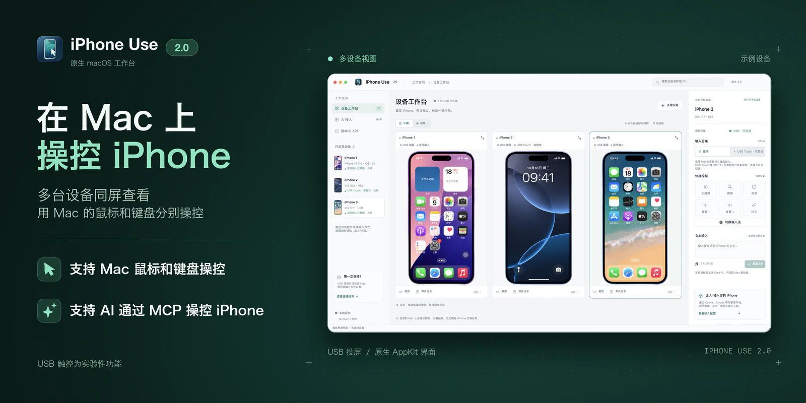

# iPhone Use

**在 Mac 上用鼠标和键盘操控真实 iPhone。** 支持 USB 投屏、多设备同屏和 AI Agent 接入。无需越狱，也不用在 iPhone 上安装应用。

简体中文 | [English](README.en.md)

[下载 macOS 版](https://github.com/YueChen-C/iPhone-use/releases) · [快速开始](#快速开始) · [接入 AI Agent](#接入-ai-agent)



## 实操演示

https://github.com/user-attachments/assets/e4aa9473-3236-4573-9841-bfbf83e248e1

## 核心功能

- **多设备 USB 投屏**：在同一个原生工作台查看多台 iPhone，并分别操控。
- **Mac 鼠标和键盘操控**：支持点击、拖动、滚动和输入，可按设备选择蓝牙或实验性 USB 触控。
- **AI 与脚本自动化**：通过 MCP 或本地 HTTP API 指定设备、截图并执行操作。

## 快速开始

1. 在 **macOS 14+** 的 Mac 上，从 [Releases](https://github.com/YueChen-C/iPhone-use/releases) 下载 **Assets** 中的 `iPhoneUse-v<版本号>-macOS-universal.zip`（支持 Apple Silicon 和 Intel），解压后将 `iPhoneUse.app` 拖入「应用程序」。安装包未经过 Apple 公证；若系统阻止打开，确认来源后按「隐私与安全性」提示操作。
2. 用可传输数据的 USB 线连接并解锁 iPhone，选择「信任此电脑」，并允许 Mac 的相机权限以获取画面。
3. 在工作台选择输入方式。**iOS 17.3+ 默认 USB 触控**；旧系统默认蓝牙。蓝牙需授权、开启 iPhone 的辅助触控并完成配对；USB 触控为实验性功能，需 iOS 17+、兼容的 Apple Silicon 主机、开发者模式和兼容 DDI。

[从源码运行](docs/user-guide.md#1-获取代码并启动) · [连接和配对](docs/user-guide.md#2-连接手机并授权) · [USB 触控配置](docs/user-guide.md#实验性原生-usb-触控) · [故障排查](docs/user-guide.md#常见问题与限制)

## 接入 AI Agent

保持 `iPhoneUse.app` 运行。安装版应用位于「应用程序」时，可用 Codex CLI 注册 MCP：

```sh
codex mcp add iphone-use -- /Applications/iPhoneUse.app/Contents/MacOS/iphone-use mcp
```

新建 Codex 会话后，可指定设备、查看画面并操作 iPhone。其他客户端及源码安装见 [MCP 配置手册](docs/user-guide.md#接入-ai-agentmcp)。

## 文档

- [使用手册](docs/user-guide.md)：窗口操作、中英文切换、校准、多设备和录屏。
- [HTTP API](docs/user-guide.md#http-api) · [原生 Accessibility 元素树](docs/native-ax-tree.md#中文使用说明)：调用示例、设备要求和兼容性限制。
- [开发与验证](docs/user-guide.md#开发与验证) · [架构](docs/architecture.md) · [发布](docs/releasing.md) · [更新日志](CHANGELOG.md)

仅在你拥有或获授权的设备上使用。发送消息、支付、删除等敏感操作请人工确认；接入第三方 AI 前请留意截图及设备数据的隐私。本项目与 Apple 无关，按 [MIT 许可证](LICENSE) 提供。
